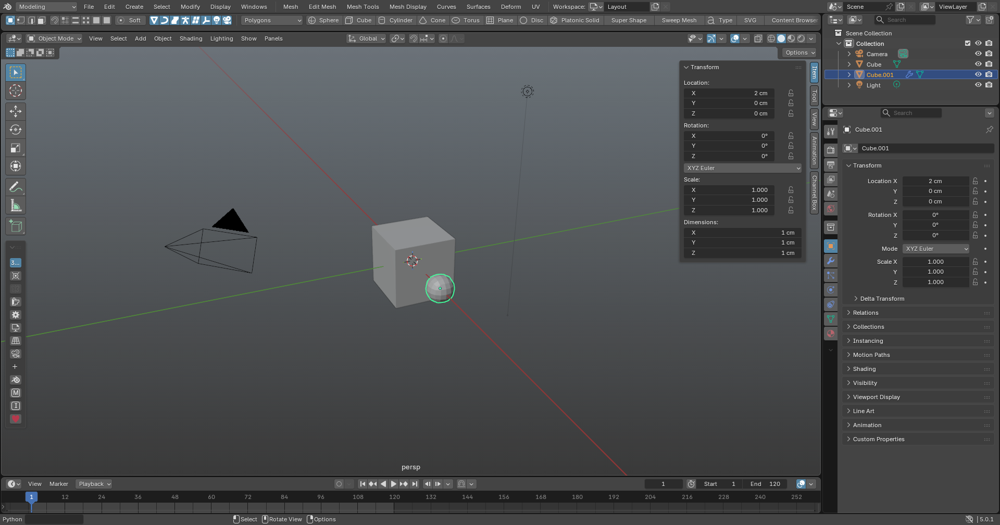
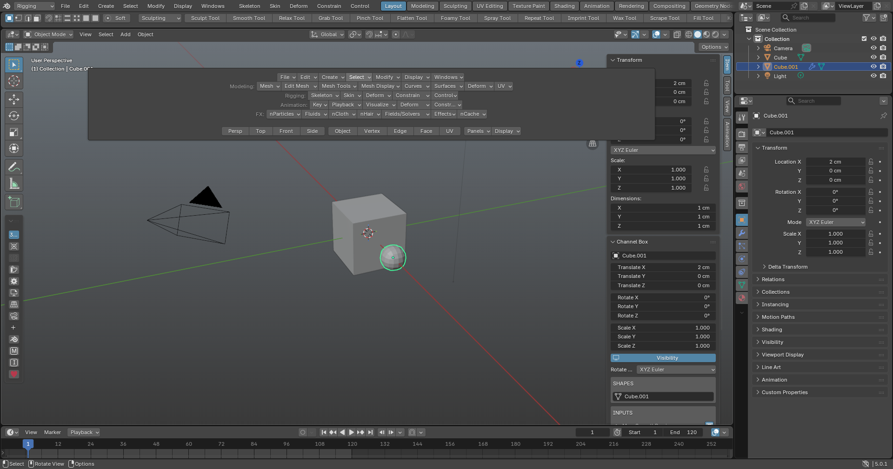
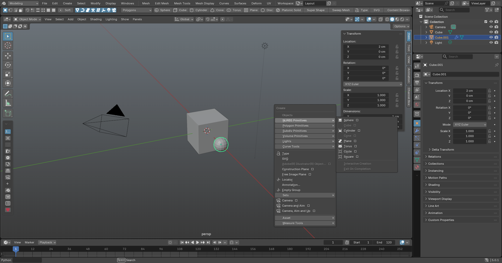

# BlenderToMaya — Maya Mode for Blender

블렌더를 **거의 마야처럼** 쓰게 만드는 프로젝트입니다.

1. **분석** — 설치된 Maya 2025의 구조, 핫키, 마킹 메뉴, 메뉴, 채널 박스를 해부 → [docs/01-maya-anatomy.md](docs/01-maya-anatomy.md)
2. **애드온** — 분석 결과를 블렌더 애드온 `Maya Mode`로 구현 → [`addon/maya_mode`](addon/maya_mode)
3. **패치 계획** — 애드온으로 불가능한 부분(Transform 피벗 스택, Construction History, Y-up 등)의 블렌더 C++ 패치 로드맵 → [docs/02-gap-and-patch-plan.md](docs/02-gap-and-patch-plan.md)

지원: Blender **4.2 이상** (4.5, 5.0에서 테스트)

## 설치

1. 직접 빌드:
   ```
   blender --command extension build --source-dir addon/maya_mode --output-dir dist
   ```
2. Blender → Edit → Preferences → Get Extensions → 우측 상단 ▾ → **Install from Disk…** → `dist/maya_mode-0.2.0.zip` 선택
3. 상단 메뉴바의 **Maya → Apply Maya Setup** 실행
   - Industry Compatible 키맵(Alt+마우스 내비게이션, QWER) 활성화
   - 단위 cm, 24 fps / 1–120 프레임, 마야식 내비게이션·뷰포트

## 무엇이 마야처럼 바뀌나





### 화면 (Apply Maya Setup 후)
- **메인 메뉴바**: `메뉴셋 ▾ | File Edit Create Select Modify Display Windows | 메뉴셋별 메뉴`
  - 메뉴셋: Modeling(F2) · Rigging(F3) · Animation(F4) · FX(F5) — 마야 메뉴 구조·순서 그대로
  - 블렌더 원래 메뉴는 왼쪽 블렌더 로고 아래에 남아 있음
  - 옵션 박스(□)가 있는 항목은 **Shift+클릭**하면 실행 후 블렌더 "Adjust Last Operation" 창이 열림 (= 마야 옵션 창)
  - 블렌더 기본 아이콘이 맞는 항목은 아이콘 표시, 없으면 텍스트만
  - 블렌더에 대응 기능이 없는 항목은 마야처럼 회색으로 표시
- **상태줄 + 쉘프**: 뷰포트 위 줄 — 선택 모드, 스냅 토글, Soft, Sym X, 오브젝트 타입별 선택 마스크, 쉘프 탭(아이콘 + 짧은 이름)(Polygons, Curves, Surfaces, Sculpting, Rigging, Animation, UV, FX …)
- **뷰포트 패널 메뉴**: Shading · Lighting · Show(오브젝트 타입별 표시) · Panels
- **채널 박스 / 레이어 에디터**: 사이드바 `Channel Box` 탭 (마야식 2열: 채널 이름 | 값). 블렌더는 탭 전환을 코드로 못 해서 처음 한 번만 탭을 클릭
- **뷰포트**: 하단 가운데 뷰 이름(persp / top / front / side), 블렌더 내비게이션 버튼 숨김
- **핫박스**: Space 홀드 → 모든 메뉴셋의 메뉴가 줄지어 펼쳐짐 (파이 방식도 선택 가능)
- **커맨드 라인**: 맨 아래 상태바에 Python 한 줄 실행
- **테마**: 마야풍 회색 UI, 파란 하이라이트, 선택 오브젝트 초록/흰색, 버텍스 보라→노랑, 엣지·페이스 주황, 타임라인 빨간 현재 프레임

### 메뉴 커버리지 (v0.2)
| 메뉴셋 | 동작하는 항목 |
|---|---|
| 공통 (File~Windows) | 378 / 549 (68%) |
| Modeling | 191 / 283 (67%) |
| Rigging | 102 / 186 (54%) |
| Animation | 98 / 157 (62%) |
| FX | 49 / 176 (27%) — 블렌더 시뮬레이션으로 대체 |
| 쉘프 | 126 / 155 |

머티리얼·렌더링 관련 항목은 의도적으로 블렌더 기본 기능을 쓰도록 남겨 둠.

### 마킹 메뉴 (파이 메뉴, 방향은 마야 기본값과 동일)
| 입력 | 메뉴 |
|---|---|
| RMB (오브젝트 위) | ↑Edge ←Vertex ↓Face →UV ↗Object Mode ↘Multi |
| RMB (빈 곳) | 선택 명령 |
| Shift+RMB (빈 곳) | 프리미티브 생성 (↓Cube →Sphere ←Cylinder ↙Cone ↖Plane ↗Disc ↘Torus) |
| Shift+RMB (오브젝트 / 버텍스 / 엣지 / 페이스) | 컴포넌트별 모델링 툴 (↓Extrude →Bevel/Chamfer ←Multi-Cut …) |
| Ctrl+RMB (컴포넌트) | 선택 변환 (To Vertices / Edges / Faces, Grow, Shrink, Loop, Ring) |
| W / E / R + LMB | 축 방향 (World / Object / Local / Normal / Gimbal), 피벗 |
| Q + LMB | 선택 방식 (Marquee / Drag / Paint / Lasso) |
| Space 홀드 | 핫박스 (Views, Selection Mode, Display, Panels, File, Edit, Mesh, Edit Mesh) |

### 핫키 요약
| 키 | 동작 |
|---|---|
| Space 탭 | 단일 ⇄ 4분할 뷰 |
| 1 / 2 / 3, PgUp / PgDn | Smooth Mesh Preview |
| 4 / 5 / 6 / 7 | 와이어 / 셰이디드 / 텍스처 / 라이트 |
| F8, F9–F12, F7 | 오브젝트⇄컴포넌트, 버텍스/엣지/페이스/UV, 멀티 |
| X / C / V (홀드) | 그리드 / 엣지 / 포인트 스냅 |
| D (홀드), Insert | 피벗 편집 |
| B, B+LMB 드래그 | 소프트 셀렉션, 반경 |
| Ctrl+G, P, Shift+P | 그룹, 페어런트, 언페어런트 |
| Ctrl+D, Shift+D | 복제, Duplicate with Transform |
| H, Ctrl+H, Alt+H, Ctrl+Shift+H | 가시성 |
| ↑ ↓ ← → | Pick-walk |
| Ctrl+E, Ctrl+B, Delete, Ctrl+Delete | Extrude, Bevel, 컴포넌트 삭제 |
| Ctrl+Shift+X, Ctrl+Shift+Q | Multi-Cut, Quad Draw |
| > / < | 선택 확장 / 축소 |
| S, Shift+W/E/R | 키 설정 |
| , . / Alt+, . / Alt+V / K+드래그 | 키 이동 / 프레임 이동 / 재생 / 스크럽 |
| + / - | 조작기 크기 |
| Ctrl+A | 채널 박스 토글 |
| G | 마지막 동작 반복 |

전체 표와 마야 원본 동작 비교는 [docs/01-maya-anatomy.md](docs/01-maya-anatomy.md) 5장 참고.

### 패널 / 메뉴
- **Channel Box / Layer Editor** — 3D 뷰 사이드바 `Channels` 탭 (Translate/Rotate/Scale, SHAPES, INPUTS=모디파이어 스택)
- **Maya 메뉴** — 상단 바: Modify(Freeze/Reset/Center Pivot/Delete History), Display, Mesh, Edit Mesh, Mesh Tools

마킹 메뉴(RMB)와 핫박스(Space)는 애드온 환경설정에서 끌 수 있습니다.

## 프로젝트 구조

```
addon/maya_mode/
  __init__.py        등록
  menu_data.py       마야 메뉴·쉘프 구조 (tools/extract_maya_ui.py 가 생성, 이름과 순서만)
  actions.py         마야 명령 757개 → 블렌더 오퍼레이터/툴/토글/에디터 매핑
  maya_menus.py      마야 메인 메뉴바, 메뉴셋, 상태줄+쉘프, 핫박스, 뷰포트 패널 메뉴, 커맨드 라인
  ops_commands.py    메뉴 명령용 오퍼레이터 (타입별 선택/숨김/삭제, 디포머, 컨스트레인트, 스킨 등)
  keymap.py          마야 기본 핫키 + 에디터별 핫키 → 블렌더 키맵 (216개 항목)
  pies.py            마킹 메뉴 (파이 메뉴)
  ops_transform.py   그룹, 복제, 홀드 스냅·피벗, 소프트 셀렉션, pick-walk, 가시성
  ops_tools.py       스무스 프리뷰, 셰이딩, 컴포넌트 모드, 모델링·Modify 명령, 키프레임, 핫박스
  channel_box.py     채널 박스 / 레이어 에디터
  menus.py           Maya 상단 메뉴
  prefs.py           환경설정, Apply Maya Setup
docs/                분석 · 갭 · 패치 계획
tools/extract_maya_ui.py  로컬 마야 설치에서 메뉴·쉘프 구조 추출 (마야가 설치된 PC에서 실행)
tests/test_addon.py  블렌더 백그라운드 테스트
tests/ui_screenshot.py  실제 UI를 띄워 스크린샷으로 확인
```

## 테스트

```
blender --background --factory-startup --python tests/test_addon.py
```
오퍼레이터 동작(그룹, Shift+D, 스무스 프리뷰, 선택 변환, 히스토리 삭제 등)과, 모든 메뉴·파이·키맵이 참조하는 오퍼레이터/속성/열거값/아이콘이 실제로 존재하는지 검증합니다.

## 법적 고지

- 이 저장소에는 Autodesk의 코드, 스크립트, 아이콘, 리소스가 포함되어 있지 않습니다. 분석 문서는 설치된 Maya의 동작을 관찰해 직접 작성한 설명이며, 바이너리는 디컴파일하지 않았습니다.
- Maya는 Autodesk, Inc.의 상표입니다. 이 프로젝트는 Autodesk와 관련이 없습니다.
- 라이선스: GPL-3.0-or-later (블렌더 애드온 요구사항)
